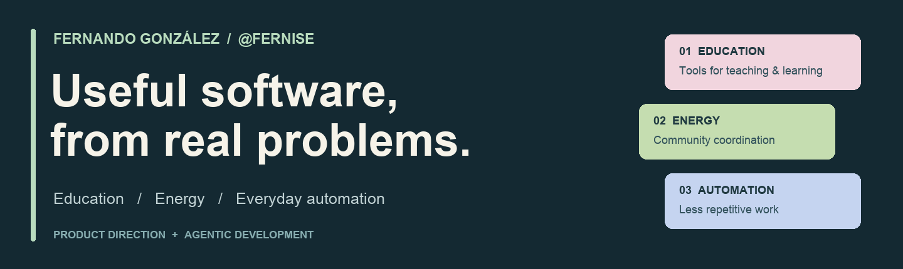
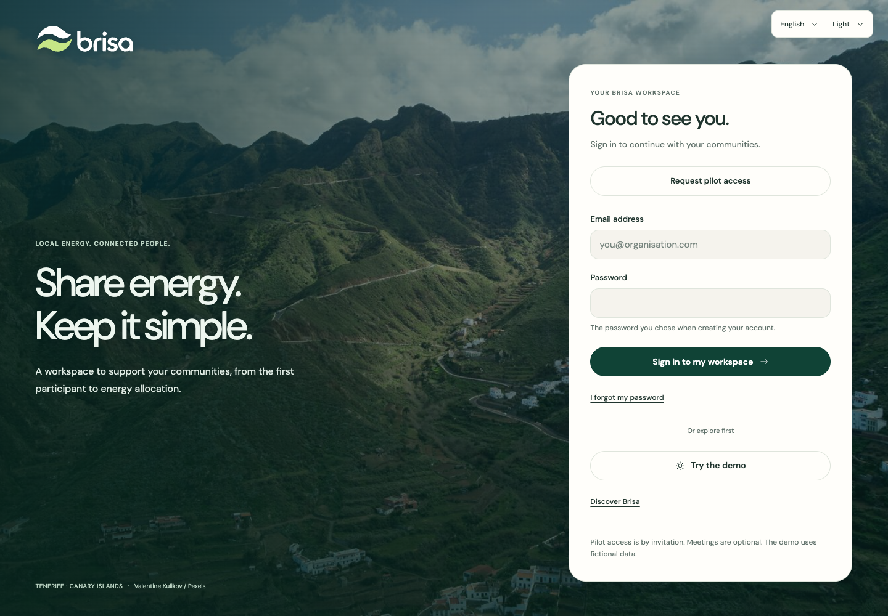
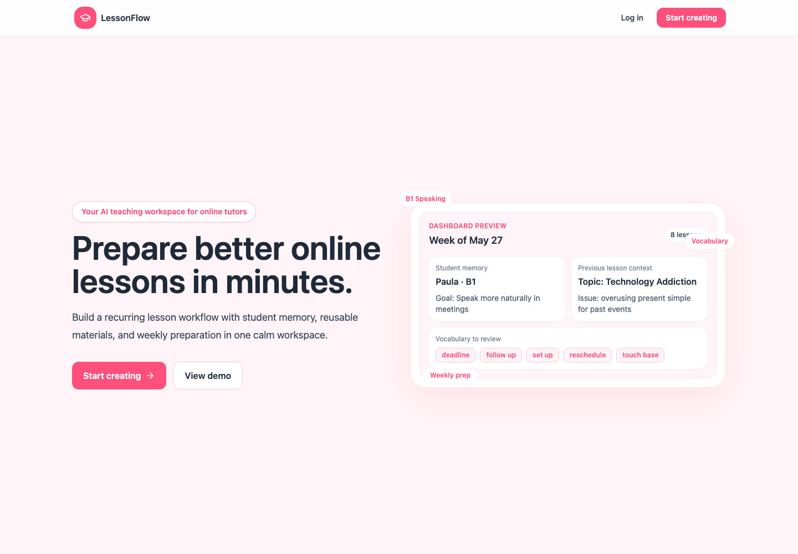
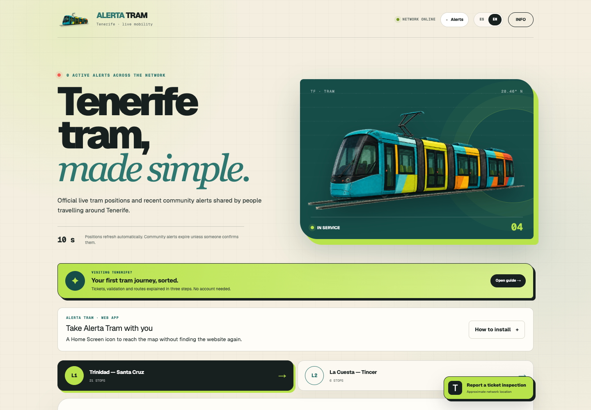

# Hi, I’m Fernando.

I build practical software for **education, energy and everyday workflows**. My work starts with a concrete problem: making lesson preparation easier, coordinating a solar community, or turning a complex document process into a usable workspace.

I’m interested in collaborating with people who know a problem well and want to shape a useful product around it.

[Connect on LinkedIn](https://www.linkedin.com/in/fernando-gonz%C3%A1lez-perdomo-8ba956217/) · [Selected projects](#selected-projects) · [How I work](#how-i-work)

## Selected projects

A selection of implemented projects with source, screenshots, setup instructions and verification notes. The repository READMEs explain their current status and integration limits.

<table>
  <tr>
    <td width="50%" valign="top">
      
      <h3><a href="https://github.com/Fernise/brisa-energy">Brisa Energía</a></h3>
      
<strong>Collective solar-community coordination.</strong> Community workspaces, energy review and budget preparation.

      
Node.js · SQLite

    </td>
    <td width="50%" valign="top">
      
      <h3><a href="https://github.com/Fernise/lessonflow-app">LessonFlow</a></h3>
      
<strong>A workspace for language teachers.</strong> Student memory, lesson planning and reusable teaching materials.

      
Next.js · TypeScript · Supabase

    </td>
  </tr>
  <tr>
    <td width="50%" valign="top">
      
      <h3><a href="https://github.com/Fernise/expediente-vv">Expediente VV</a></h3>
      
<strong>Clearer holiday-rental document workflows.</strong> Property dossiers, private documents and professional review.

      
React · TypeScript · Cloudflare

    </td>
    <td width="50%" valign="top">
      
      <h3><a href="https://github.com/Fernise/alerta-tram-tenerife">Alerta Tram Tenerife</a></h3>
      
<strong>A clearer view of Tenerife’s tram network.</strong> Tram positions, occupancy and recent community alerts.

      
React · TypeScript · Cloudflare

    </td>
  </tr>
</table>

*Previews are local interface captures using demo or fictional content. They do not establish live service availability.*

## More projects

| Project | What it explores |
| --- | --- |
| [Luma](https://github.com/Fernise/luma-learning) | Adaptive activities for fractions, patterns and logic, with optional AI interpretation. |
| [AgroCanary](https://github.com/Fernise/AgroCanary) | Direct produce enquiries between Canary Islands growers and buyers. |
| [Gurkerl Recommender MCP](https://github.com/Fernise/gurkerl-recommender-mcp) | Explainable grocery ranking, offer monitoring and weekly digests. |
| [Jarvis](https://github.com/Fernise/jarvis) | A personal workflow assistant for transcript capture and teaching preparation. |
| [Lunch Finder](https://github.com/Fernise/lunch-finder) | Nearby lunch shortlists from configurable menu sources, delivered through Telegram. |

## How I work

- **Start with the workflow.** Clarify who needs the product, what is difficult today and which decisions matter.
- **Build with context.** Turn requirements and domain constraints into a usable interface and a maintainable implementation.
- **Check the result.** Use tests, local rehearsals and clear documentation to show what works and what still needs validation.

I use **agentic programming with OpenAI Codex** for implementation, refactoring, testing and documentation. I set the product direction, requirements and final decisions. Each repository records its own verification and limitations.

**Tools in these projects:** Python · TypeScript · JavaScript · React / Next.js · Node.js · SQL / SQLite · Supabase · Cloudflare · MCP

## Let’s collaborate

If you’re exploring a product in education, energy, document workflows or practical automation, I’d be glad to hear about the problem you’re trying to solve.

**[Start a conversation on LinkedIn →](https://www.linkedin.com/in/fernando-gonz%C3%A1lez-perdomo-8ba956217/)**
